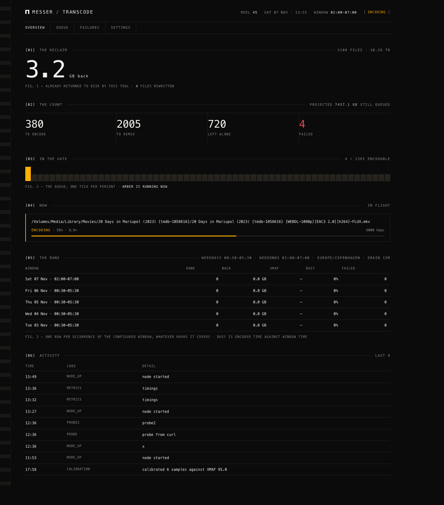

# messer-transcode

A transcode pipeline that runs itself.

One Go binary, two roles: an **orchestrator** in a container that owns the queue
and every decision, and a **native worker** on the host that does the encoding
with Apple's VideoToolbox. The container never mounts the media library. A
component that cannot touch the films cannot damage them.

```
                     ┌──────────────────────────────┐
   browser ─────────▶│  orchestrator (container)    │
                     │  queue · rules · UI · verdict │
                     └──────┬───────────────▲───────┘
                            │ claim         │ progress, result
                     ┌──────▼───────────────┴───────┐
                     │  node (macOS, PM2)           │
                     │  ingest → encode → verify →  │
                     │  atomic replace → quarantine │
                     └──────┬───────────────────────┘
                            │ VideoToolbox, ffmpeg
                     ┌──────▼───────────────────────┐
                     │  /Volumes/Media              │
                     └──────────────────────────────┘
```

## What it does

Scans a library, decides per file, and re-encodes only what is worth
re-encoding. On a 3,109-file, 10.26 TB library it wanted:

| | files | decision |
|---|---:|---|
| encode | 380 | H.264 or over-bitrate HEVC → HEVC at a measured target |
| remux | 2,005 | container and stream cleanup, no quality loss |
| leave alone | 720 | already lean, or a projected saving under 10 % |
| unreadable | 4 | zero-byte files that predate this tool |

Projected: **669 GB** returned to disk. Tdarr's flow wanted to *re-encode* 92 %
of the same library; this re-encodes **12 %** and touches the rest only to remux
or not at all.

<p align="center">
  
</p>

## The four ideas it is built on

**A flat, ordered rule list.** Not a 39-node visual flow. The last rule is the
default, the list is validated before it runs, and every decision carries the
code that produced it (`R_H264_ENCODE`, `R_ALREADY_LEAN`, `R_QUALITY_FLOOR`).

**A measured quality target, not a guessed bitrate.** `calibrate` encodes real
windows of your own films at several bitrates and reports the VMAF curve. Here
that produced 6,000 kbps for HEVC at VMAF 95.0, and 92.9 as the honest
expectation for H.264 sources — which top out lower because the grain is
already gone. Content that cannot reach the floor is **skipped and left
untouched**, not retried forever.

**Nothing is ever deleted.** Encode to scratch, verify, `fsync`, atomic rename,
then the original moves to a dated quarantine. A failure at any step leaves the
library exactly as it was.

**One media engine, respected.** Four concurrent ffmpeg processes on the media
volume collapse throughput to 0.3×. One worker, and the encoder never waits for
I/O: ingest and placement run in their own lanes. Measured idle time between
files: **0.2 %**.

## Quick start

```sh
go build -o bin/messer-transcode ./cmd/messer-transcode
./bin/messer-transcode validate config.example.json
./bin/messer-transcode plan  --config config.json --db state.db
./bin/messer-transcode serve --config config.json --db state.db
./bin/messer-transcode node  --config config.json --token-file server.token
```

`doctor` answers whether the thing works at all, with one verdict object and an
exit code a script can branch on:

```
$ messer-transcode doctor --config config.json
[  ok  ] config     2 libraries, window 00:30-05:30
[  ok  ] database   3109 files, integrity ok
[  ok  ] binaries   ffmpeg and ffprobe present, dependencies resolve
[  ok  ] encoder    hevc_videotoolbox encoded a test frame
[  ok  ] disk       scratch has 789 GB free
[  ok  ] node       last activity 1m0s ago
[  ok  ] window     weekday 00:30-05:30, weekend 02:00-07:00, drain 15m
[  ok  ] progress   last finished encode 1h15m0s ago

status: ok
```

A failing check names the code and the command that fixes it — `E_NODE_SILENT`
when work is queued and nothing has reported, `E_BINARY_MISSING` when a Homebrew
upgrade has removed a library out from under ffmpeg, `E_ENCODER_UNAVAILABLE`
when the hardware encoder refuses a test frame.

And it accounts for itself afterwards. A **run** is one occurrence of the
configured window, whatever hours that window covers — this is a real capture
from a deliberately short window set to 13:29–13:38 to prove the scheduling:

```
$ messer-transcode report --last 1
schedule  13:29-13:38 weekdays · 13:29-13:38 weekends · Europe/Copenhagen

  Sat 07 Nov 13:29–13:38 (weekend): 2 done (0 encoded, 2 remuxed), 0.31 GB reclaimed, 98% of the window busy
```

## Documentation

| | |
|---|---|
| [docs/PLAN.md](docs/PLAN.md) | the specification and the decision record |
| [docs/calibration.md](docs/calibration.md) | the VMAF curves and where they came from |
| [docs/operations.md](docs/operations.md) | deployment, the window, draining, the token |
| [docs/server.md](docs/server.md) | the API and why the database is the state |
| [docs/lanes.md](docs/lanes.md) | prefetch and placement, and the two metrics that lied |
| [docs/history-tdarr.md](docs/history-tdarr.md) | what this replaced, and why |

## Status

Running on a real library since November 2026. The pipeline, the orchestrator,
the worker, health checks and the run report are complete; the public release is
the last milestone. Apple silicon only: `hevc_videotoolbox` is the point, and
the worker has to run where the hardware encoder lives.

## Contributing

Issues are welcome — bug reports and ideas alike. I do not accept pull requests:
this is a tool shaped around one library and one machine, and outside patches
would have to be maintained against that. See [CONTRIBUTING.md](CONTRIBUTING.md).

## License

MIT © 2026 Jakob Bjelvér
